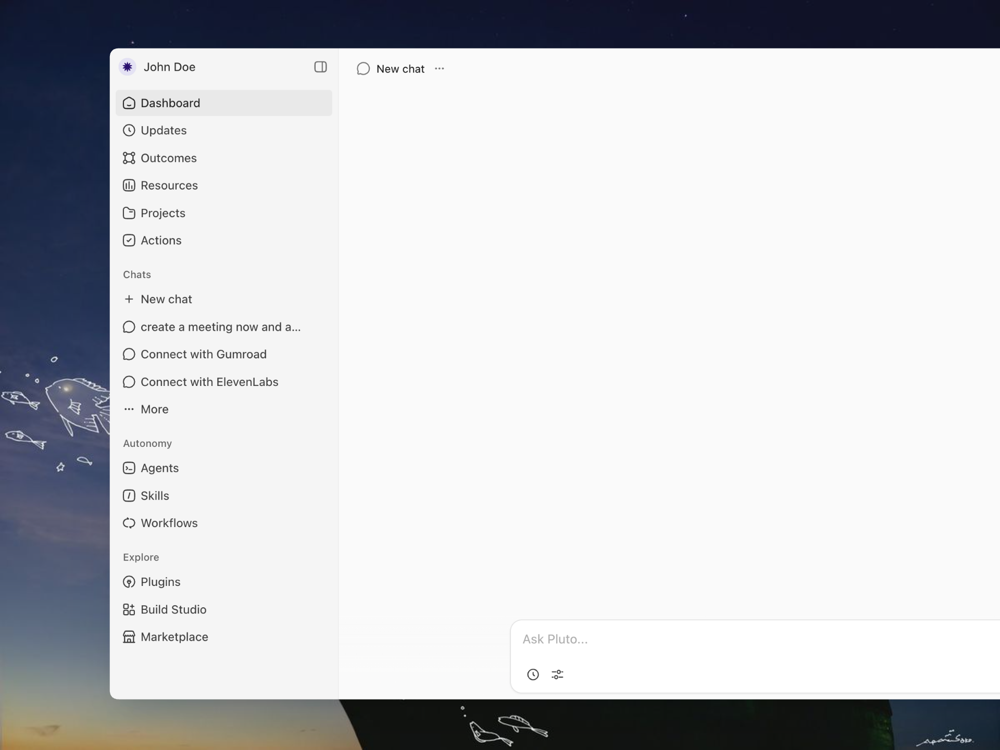

Pluto is an AI-native workspace that brings work management, team collaboration, organizational knowledge, and autonomous AI agents together in one unified platform. Plan outcomes, manage projects, automate workflows, and build custom applications—all in one place.

<Note>
  Ready to make this your own? Start by editing this page. Update your `docs.json` file to customize your site. Then fill out the [Quickstart](/quickstart) page.
</Note>

<Columns cols={2}>
  <Column>
    <Card title="Quickstart" icon="rocket" href="/quickstart">
      Get started with Pluto. Set up your workspace, invite your team, and explore the tools you need to manage work with AI.
    </Card>

    <Card title="AI Workforce" icon="users-round" href="https://mintlify.com/docs/organize/settings">
      Set your site name, branding, and navigation in the `docs.json` file.
    </Card>
  </Column>
  <Column>
    <Card title="Work management" icon="chart-pie" href="https://mintlify.com/docs/components">
      Turn company goals into actionable projects and tasks. Track progress, manage dependencies, and keep teams aligned.
    </Card>
  </Column>
</Columns>
